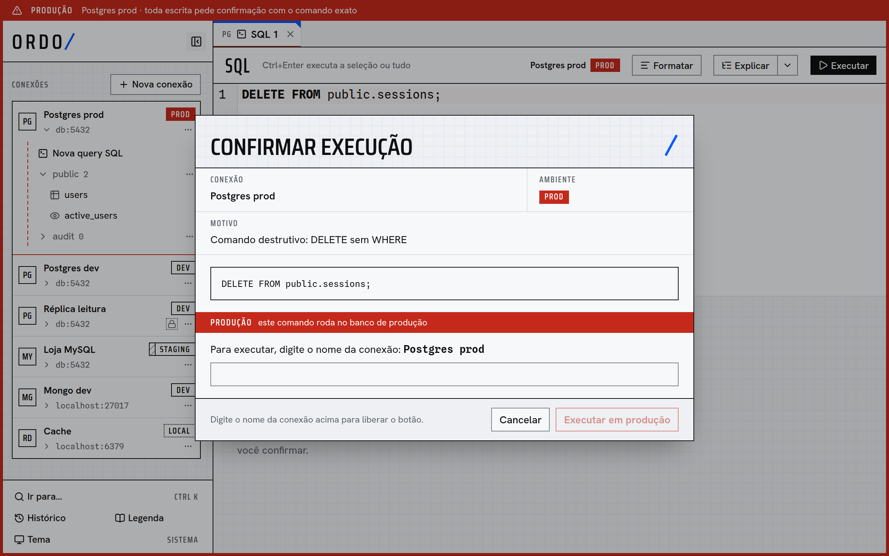

# Ordo

Cliente desktop para Postgres, MySQL, SQLite, MongoDB e Redis, feito para não deixar você rodar sem querer um comando destrutivo em produção.



<sub>Dados de demonstração. A interface é em português do Brasil.</sub>

## Por que o Ordo

- **O ambiente nunca é ambíguo.** Cada conexão tem uma etiqueta (`local`, `dev`, `staging`, `prod`), e uma conexão `prod` marca a janela inteira.
- **O comando exato antes do clique.** Em `prod`, toda escrita pede confirmação mostrando o que vai rodar. Comandos destrutivos são detectados por um parser de SQL, não por regex, e também confirmam fora de `prod`.
- **Somente leitura de verdade.** Quem impõe é o próprio banco (`default_transaction_read_only` no Postgres, `READ ONLY` no MySQL, `mode=ro` no SQLite); no MongoDB e no Redis, uma lista de comandos permitidos no backend.
- **O valor gravado, não uma aproximação.** Inteiros de 64 bits e decimais não passam por conversão com perda, e um tipo que o app não conhece aparece sem edição, em vez de ser alterado.
- **Cada modelo de dados com a sua interface.** Grade para SQL, documentos para MongoDB e editor por tipo para Redis, num só app em Tauri + Rust, sem JVM.

## O que dá para fazer

| Engine                      | Recursos                                                                                                                                                                                                                                                   |
| --------------------------- | ---------------------------------------------------------------------------------------------------------------------------------------------------------------------------------------------------------------------------------------------------------- |
| **Postgres, MySQL, SQLite** | Navegar tabelas com filtro e ordenação, editar células e salvar numa transação, seguir chaves estrangeiras, editor com autocomplete, parâmetros `:nome` e EXPLAIN visual, editar o schema vendo o DDL, diagrama ER, comparar schemas, importar CSV, backup |
| **MongoDB**                 | CRUD de documentos, agregação em JSON ou em blocos de estágios, schema por amostra, índices, change streams, importar JSON e NDJSON                                                                                                                        |
| **Redis**                   | Standalone, Cluster e Sentinel, navegação por `SCAN`, edição por tipo (RedisJSON incluso), TTL, console, pub/sub, `MONITOR`, exportar chaves                                                                                                               |

Em todas: histórico pesquisável com favoritas, exportação em streaming (CSV, NDJSON ou JSON, conforme a engine) e paleta de busca (Ctrl+K). Túnel SSH, TLS e grupos de conexões valem onde a engine permite. Sessões ativas e encerramento de sessão valem para todas, menos o SQLite.

## Instalação

Baixe o pacote em [Releases](https://github.com/martinsgabriel1956/db-manager/releases/latest):

```bash
# Debian, Ubuntu e derivados
sudo apt install ./Ordo_*_amd64.deb
```

```bash
# Fedora, RHEL e derivados
sudo dnf install ./Ordo-*.rpm
```

```bash
# Outras distribuições Linux
chmod +x Ordo_*_amd64.AppImage
./Ordo_*_amd64.AppImage
```

No Windows, use o instalador `.exe`; no macOS, o `.dmg` (universal). Eles não têm assinatura de código: o SmartScreen avisa no Windows, e no macOS é preciso abrir pela primeira vez com o botão direito → Abrir. No Arch, o pacote `ordo-db` do AUR ainda não foi publicado.

Para conferir o que baixou, use o `SHA256SUMS` do release:

```bash
sha256sum -c SHA256SUMS --ignore-missing
```

### O que mais o app usa

- **Linux:** um Secret Service rodando (GNOME Keyring ou KWallet) para guardar senhas. Sem ele, a conexão é salva, mas a senha não; o app avisa e nunca grava a senha em texto puro.
- **Túnel SSH:** o `ssh` do sistema.
- **Backup e restauração:** `pg_dump`, `pg_restore` e `psql` para o Postgres; `mysqldump` e `mysql` para o MySQL. O backup do SQLite não precisa de nada externo.

## Primeiros passos

1. Clique em **Nova conexão**, escolha a engine e preencha os dados.
2. Escolha o **ambiente**. É ele que define as confirmações, então marque como `prod` o que for produção.
3. Use **Testar conexão**, que não salva nada, e salve.
4. Abra a conexão na lateral. **Legenda** explica cada marca e lista os atalhos.

Para experimentar sem apontar para um banco seu, use os [bancos de demonstração](#bancos-de-demonstração).

Fechar a janela deixa o Ordo na bandeja, com conexões e abas intactas. Para sair, use **Sair** na bandeja ou **Ctrl+Q**.

## Atualizações

O app procura uma versão nova ao abrir e em **Procurar atualizações**, na bandeja, e só instala depois de você confirmar. O `.deb` e o `.rpm` pedem a senha de administrador. Quem instala pelo AUR atualiza pelo gerenciador de pacotes; o app só avisa e aponta para a página do release.

## Onde ficam os dados

Metadados das conexões, em `connections.json`:

| Sistema | Pasta                                                      |
| ------- | ---------------------------------------------------------- |
| Linux   | `~/.local/share/dev.nemomartins.dbmanager/`                |
| macOS   | `~/Library/Application Support/dev.nemomartins.dbmanager/` |
| Windows | `%APPDATA%\dev.nemomartins.dbmanager\`                     |

Senhas: keychain do sistema, serviço `db-manager`, usuário = id da conexão (`<id>:ssh` para a senha do túnel SSH e `<id>:sentinel` para a do Sentinel). O nome antigo do app continua nesses identificadores de propósito: trocá-los apagaria conexões e senhas salvas.

## Problemas de conexão

No formulário, **Testar conexão** conecta com o que está preenchido, sem salvar nada nem tocar no keychain. Os erros mais comuns:

- **Recusou a conexão / timeout:** confira host e porta, e se o banco aceita conexões de fora (`listen_addresses` no Postgres, `bind-address` no MySQL, `bind` no Redis). Para um banco atrás de bastion, marque **Conectar por túnel SSH** e informe host e porta como o bastion os vê.
- **Túnel SSH:** usa o `ssh` do sistema. Sem senha SSH no formulário, roda em modo não interativo: só chave sem passphrase ou agente (`ssh-add`). Com ela, a mesma senha responde à senha do usuário ou à passphrase da chave; fica no keychain (usuário `<id>:ssh`) e chega ao `ssh` pelo ambiente do processo (`SSH_ASKPASS`, OpenSSH 8.4 ou mais novo), nunca pela linha de comando. Vale o `~/.ssh/config` (aliases, `ProxyJump`, `User`, `IdentityFile`); um host desconhecido entra no `known_hosts` na primeira vez, e uma chave de host trocada é recusada. Se falhar, a mensagem do `ssh` aparece no erro; confira com `ssh -N -L 15432:host:porta bastion` no terminal.
- **Senha ou usuário recusados:** a senha salva fica no keychain; ao editar, deixe o campo vazio para manter a salva ou digite outra.
- **TLS:** "Exigir" recusa servidores sem TLS; "Exigir e verificar certificado" precisa do certificado CA quando ele não é público.
- **MongoDB por URI:** a URI inteira (`mongodb://` ou `mongodb+srv://`) é o segredo; TLS e autenticação vêm dela.
- **Keychain indisponível (Linux sem Secret Service):** a conexão é salva, mas a senha não; o app avisa e nunca grava a senha em texto puro.

## Desenvolvimento

Pré-requisitos:

- Rust stable (`~/.cargo/bin` no PATH), Node 24, pnpm (`corepack enable`)
- Linux: `libwebkit2gtk-4.1-dev libayatana-appindicator3-dev librsvg2-dev libdbus-1-dev`
- Docker, para os testes de integração dos adapters
- Opcional: `postgresql-client` e `mysql-client`. Sem eles, os testes de backup e restauração avisam "PULADO", exceto no CI

```bash
pnpm install
pnpm tauri dev            # app em modo dev (também regenera src/bindings.ts)
pnpm test:coverage        # front: Vitest, gate de 70%
pnpm typecheck
pnpm format

cd src-tauri
cargo test                # back: unitários + regenera src/bindings.ts
cargo test -- --ignored   # toca o keychain real do SO
cargo llvm-cov --ignore-filename-regex '(main|lib)\.rs$' --fail-under-lines 70
```

Para gerar um pacote local, sem publicar e sem chave de assinatura:

```bash
pnpm tauri build --bundles deb    # sai em src-tauri/target/release/bundle/deb/
```

`src/bindings.ts` é gerado pelo `tauri-specta` a partir dos tipos Rust. Não edite à mão; o CI falha se estiver desatualizado.

Decisões de design e notas de implementação ficam em [docs/decisions.md](docs/decisions.md); como publicar uma versão, em [docs/release.md](docs/release.md).

### Bancos de demonstração

```bash
docker compose -f dev/demo/compose.yml up -d     # Postgres (55432), MySQL (53306), MongoDB (57017) e Redis (56379), populados na 1ª vez
python3 dev/demo/make-sqlite.py                  # gera dev/demo/demo.sqlite
docker compose -f dev/demo/compose.yml down -v   # para e apaga os dados
```

Dados e credenciais em [dev/demo](dev/demo) (descartáveis, só local).

## Créditos

O diagrama ER é desenhado com [React Flow](https://reactflow.dev) (licença MIT); o crédito fica aqui, não no canto do diagrama.

## Licença

[MIT](LICENSE).
